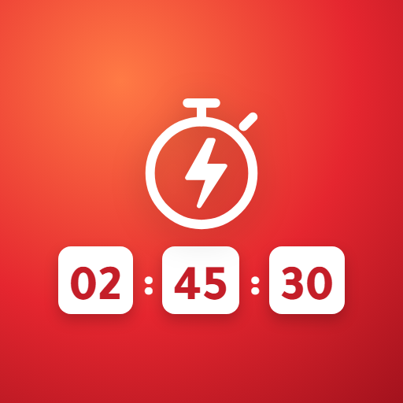
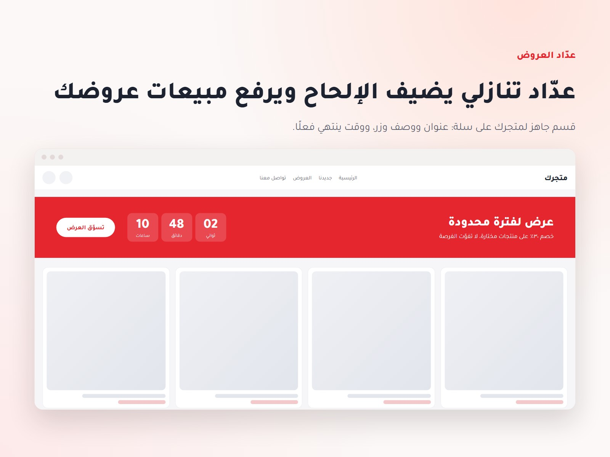
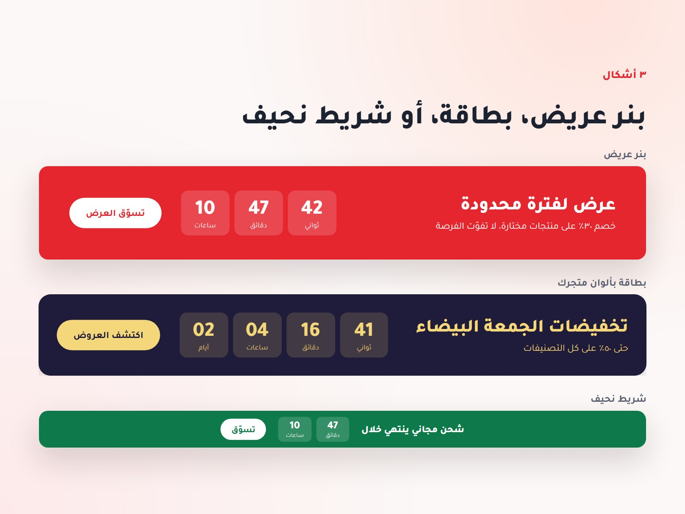
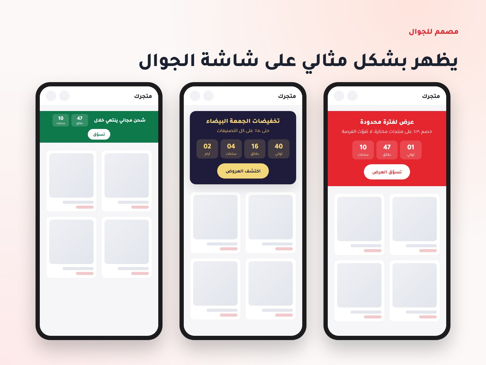
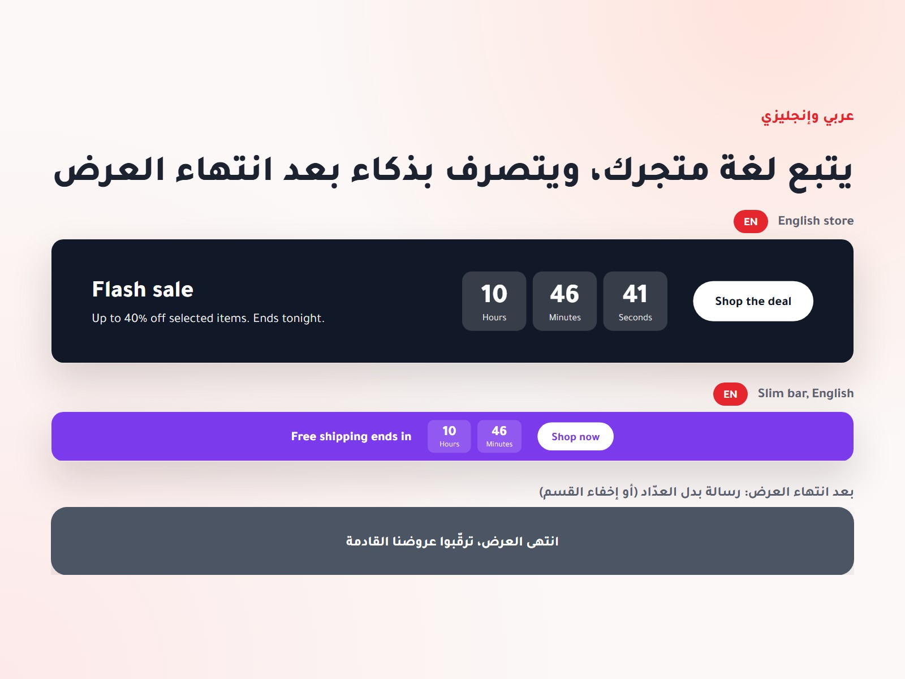

<h1 align="center">عدّاد العروض | Flash Sale Countdown</h1>

قسم لمتاجر سلة يعرض عدّادًا تنازليًا حيًّا حتى نهاية عرضك A Salla store section with a live countdown to the end of your offer

<a href="#english">English guide ↓</a>

---

## الدليل بالعربي

يضيف القسم عنوانًا ووصفًا وزرًا مع عدّاد ينتهي فعلًا، فيشجّع العميل على الشراء قبل انتهاء الوقت.

### إضافة القسم لمتجرك

1. ثبّت **عدّاد العروض** من متجر الثيمات في سلة.
2. من لوحة تحكم متجرك افتح **المظهر ← تخصيص الثيم**.
3. أضف قسمًا جديدًا للصفحة الرئيسية واختر **عدّاد العروض**.
4. عدّل الإعدادات (بالأسفل) ثم احفظ.

### الإعدادات

| الإعداد | ماذا يفعل |
|---|---|
| **العنوان والوصف** | النص الظاهر بجانب العدّاد، بالعربي والإنجليزي. |
| **متى ينتهي العرض؟** | **عرض اليوم**: ينتهي ويتجدد تلقائيًا كل منتصف ليل بتوقيت السعودية (الافتراضي، يعمل مباشرة). **في تاريخ ووقت محدد**: ينتهي في الوقت الذي تختاره. |
| **تاريخ ووقت انتهاء العرض** | يُستخدم فقط مع «في تاريخ ووقت محدد». الوقت بتوقيت السعودية مهما كان مكان الزائر. |
| **نص الزر ورابطه** | الزر يظهر فقط إذا كتبت نصه واخترت رابطًا: منتج، تصنيف، ماركة، صفحة، صفحة العروض، أو رابط مخصص. |
| **شكل القسم** | **بنر عريض** بعرض الصفحة، **بطاقة** بزوايا دائرية، أو **شريط نحيف** مناسب أعلى الصفحة. |
| **لون الخلفية ولون النص** | استخدم ألوان متجرك. لون النص يُستخدم أيضًا لخلفية الزر. |
| **صورة الخلفية** | اختيارية. تظهر خلف النص مع طبقة من لون الخلفية حتى يبقى النص واضحًا. |
| **إظهار الثواني** | أوقفه إذا أردت عدّادًا أهدأ (ساعات ودقائق فقط). |
| **بعد انتهاء العرض** | **إخفاء القسم** (الافتراضي) أو **إظهار رسالة** تكتبها في «رسالة انتهاء العرض». |

### ملاحظات

- الأيام تظهر تلقائيًا عندما يتبقى يوم أو أكثر.
- لغة القسم واتجاهه يتبعان لغة المتجر (عربي من اليمين، إنجليزي من اليسار).
- القسم مصمم للجوال أولًا ويتكيّف مع كل الشاشات.

### الدعم

للمساعدة في التثبيت أو الإعداد أو الإبلاغ عن مشكلة: **yshatory@gmail.com**، أو عبر بيانات التواصل في صفحة القسم على متجر سلة.

---

## English guide

The section shows a title, subtitle and button with a timer that really ends, nudging shoppers to buy before time runs out.

### Add the section to your store

1. Install **Flash Sale Countdown** from the Salla theme store.
2. In your store dashboard, open **Appearance → Customize theme**.
3. Add a new home-page section and choose **Flash Sale Countdown**.
4. Adjust the settings (below) and save.

### Settings

| Setting | What it does |
|---|---|
| **Title and subtitle** | The text beside the timer, in Arabic and English. |
| **When does the offer end?** | **Deal of the day**: ends and restarts every midnight, Saudi time (the default; works straight away). **At a set date and time**: ends when you choose. |
| **End date and time** | Used only with "At a set date and time". Read as Saudi time, wherever the visitor is. |
| **Button text and link** | The button appears only when it has both text and a link: a product, category, brand, page, the offers page, or a custom URL. |
| **Style** | **Bold banner** across the page, **card** with rounded corners, or **slim bar** that suits the top of the page. |
| **Background and text colors** | Use your store colors. The text color is also the button's background. |
| **Background image** | Optional. Shown behind the text with a tint of the background color so the text stays readable. |
| **Show seconds** | Turn off for a calmer timer (hours and minutes only). |
| **After the offer ends** | **Hide the section** (default) or **show a message** you write in "Offer ended message". |

### Notes

- Days appear automatically when a day or more is left.
- The section's language and direction follow your store (Arabic right-to-left, English left-to-right).
- Built mobile-first; it adapts to every screen size.

### Support

For help with installation, setup or a bug report: **yshatory@gmail.com**, or the contact details on the section's page in the Salla store.
